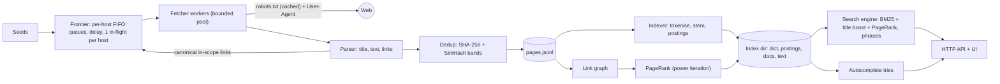

# Search Engine From Scratch

A mini Google in Go with **no search libraries**: a polite concurrent crawler, a positional inverted index on disk, BM25 + PageRank ranking, exact phrase queries, snippets with highlighting, and trie-based autocomplete, served over an HTTP API and a small web UI.

[](https://github.com/Alkarim786/search-engine-from-scratch/actions/workflows/ci.yml)


> Project 11 of Karim's 30 Days, 30 Projects series.

## Why this exists

Search is the textbook "systems + algorithms" problem: you have to crawl without hurting anyone's server, store a huge sparse matrix compactly, rank by something better than keyword counts, and answer in milliseconds. This project implements each stage by hand (the only dependency is `golang.org/x/net` for HTML tokenising and charset decoding) so every design decision is visible and measurable.

It was run against a real corpus: **1,808 pages from the Python, Django, Go, Rust and Kubernetes documentation**, 4.05 M tokens, indexed in 14 s into 22 MB. See [Benchmarks](#benchmarks--evaluation).

## Architecture



**Data flow.** The crawler pulls URLs from the *frontier*, which hands out at most one URL per host at a time and only after that host's politeness delay has elapsed. Each page is parsed into title, visible text and links; duplicate content is dropped; in-scope links are canonicalised and queued. Stored pages go to `pages.jsonl`. The *indexer* reads that file, assigns docIDs, tokenises (lower-case, stopwords, Porter stemmer), writes delta/varint-compressed positional postings, resolves the link graph among crawled pages and runs PageRank. The *server* memory-maps nothing: it loads the term dictionary and doc table (a few MB) and reads postings with `ReadAt` on demand.

## Tech stack

| Piece | Choice | Why |
|---|---|---|
| Language | Go 1.27 | Cheap goroutines for the crawler, fast single static binary, good `net/http` and `testing` |
| HTML | `golang.org/x/net/html` (+ `charset`) | The streaming tokenizer is robust to broken markup and avoids building a DOM |
| Index storage | Custom immutable files, `uvarint` + delta coding | Smaller than JSON/BoltDB for postings, trivially mmap/`ReadAt`-able, zero dependencies |
| Ranking | BM25 + title boost + PageRank prior | The standard lexical baseline, plus a link-authority signal |
| Stemming | Own Porter implementation, 70+ reference vectors | Conflates `compilers/compiling/compiler`; no NLP dependency |
| Autocomplete | Prefix trie with top-k cached per node | O(len(prefix)+k) lookups regardless of how many entries share the prefix |
| Packaging | Multi-stage Dockerfile, Compose, GitHub Actions | One command to run; CI crawls a local site end to end |

## Features (implemented)

**Crawler**
- Concurrent worker pool (default 8) with a **per-host FIFO frontier**: configurable minimum delay between requests to one host, never more than one in-flight request per host, hosts proceed in parallel.
- **robots.txt** (RFC 9309): user-agent groups, longest-match `Allow`/`Disallow`, `*` and `$` wildcards, `Crawl-delay`. Cached per host. Missing file → allow; 5xx/unreachable → treat the site as disallowed for this crawl.
- Identifying `User-Agent` with a contact URL, 2 MiB body cap, per-request timeout, HTML-only.
- **URL canonicalisation** (lower-case scheme/host, drop default ports/fragments/userinfo/`utm_*`, resolve `..`, sort query params) + global seen-set.
- **Content dedup**: SHA-256 for exact copies, 64-bit **SimHash over 3-word shingles** (Hamming distance ≤ 3, found with 4×16-bit band tables so lookups are exact, not a scan).
- Scope control: host allowlist, path-prefix filter, max depth, max pages, skipped binary extensions. Redirects are *re-queued* (so they pass scope, robots and rate limits) rather than followed blindly.
- Honours `<meta name=robots content="noindex,nofollow">` and `rel=nofollow`.

**Index and ranking**
- Positional inverted index: `term → [(docID, tf, positions…)]`, doc lengths, immutable files, delta + varint compression.
- **BM25** (k1 = 1.2, b = 0.75, Lucene's non-negative idf) with a **title boost**.
- **PageRank** by power iteration (d = 0.85, L1 tolerance 1e-6, dangling nodes redistributed uniformly, iteration count reported).
- Final score = `w1·BM25 + w2·ln(1 + N·PageRank)`, defaults `w1 = 1`, `w2 = 0.5`.
- **Phrase queries** (`"state of the art"`) using positions; stopwords inside a phrase keep their distance. AND mode, pagination.
- Snippets: best passage by distinct-term coverage, stemmed matches highlighted with `<mark>`, HTML-escaped.
- **Autocomplete**: whole-title/past-query completion plus last-word completion from the corpus vocabulary; queries you run feed back into the ranking of suggestions.

**Service**
- `GET /search`, `GET /suggest`, `GET /stats`, `GET /healthz`, admin `POST /crawl` (bearer token) that crawls, rebuilds and hot-swaps the index; single-page web UI with suggestions, highlighting and a PageRank-weight knob.

## Roadmap (not built)

- Sharded index (document-partitioned) and multi-segment indexing with background merges (today: one segment per build).
- Skip lists / block-max WAND for early termination on very long postings lists.
- Spelling correction ("did you mean", edit distance over the dictionary).
- Incremental re-crawl with `If-Modified-Since` / ETag and change detection.
- Anchor-text indexing; query-time synonym expansion (the main source of the misses listed in the evaluation).
- JavaScript rendering (the crawler only reads server-rendered HTML).

## Key engineering decisions and trade-offs

- **Politeness is a scheduling property, not a sleep().** `frontier.Next` blocks until some host is both *idle* and *past its delay*, so a slow site never stalls the others, and the "one request in flight per host" invariant is enforced in one place (and tested with concurrent workers).
- **Redirects re-enter the frontier.** Following a 301 inside `http.Client` would bypass the seen-set, scope check and rate limit, and made the same page get fetched twice in a test I wrote. Now the target is queued like any other link.
- **Conservative robots semantics.** A 5xx on `/robots.txt` disallows the host for the crawl (the safer reading of RFC 9309); a 404 allows everything.
- **Near-duplicate detection without O(n²).** Two 64-bit SimHashes within Hamming distance 3 must agree exactly on at least one of four 16-bit bands (pigeonhole), so each new page does 4 map lookups instead of comparing with every stored fingerprint. Pages under 40 words use only the exact hash because their SimHash is unreliable.
- **Index = immutable files.** No in-place updates, so no write-ahead log, no locking on the read path, and a new index can be built beside the live one and swapped in under one `RWMutex` (`server.swap`).
- **Title/body in one position space.** Title tokens get the first positions, then a one-word gap, then the body. "Appears in the title" is just `firstPosition < titleLen`, with no second index; the gap stops phrases matching across the boundary (tested).
- **Stopwords are not indexed but they do take up positions**, so `"state of the art"` requires `state` and `art` to be exactly three words apart.
- **`ln(1 + N·PageRank)` instead of `ln(PageRank)`.** Raw `ln(PR)` is large and negative (~ −8 for 1,800 pages) and would dominate BM25. Scaling by the corpus size N gives 0 for an average-authority page and a gentle positive bump above it. The weight sweep below shows why `w2` must stay small: at `w2 ≥ 2` authority swamps relevance and quality collapses.
- **Known limits:** purely lexical (no synonyms/embeddings), single-machine, whole dictionary held in RAM (42 K terms = 0.6 MB on disk here; web scale would need an FST or term sharding), snippets re-tokenise the stored page on every request, and multi-word autocomplete is crude: the last word is completed by raw corpus frequency, so `list comp` suggests `list components` before `list comprehensions`.

## Quick start

```bash
git clone https://github.com/Alkarim786/search-engine-from-scratch && cd search-engine-from-scratch
docker compose up --build      # crawls 100 pages of the Python tutorial at 1 req/s (~2 min), indexes, serves
# open http://localhost:8080
```

Crawl something else, or more:

```bash
CRAWL_SEEDS=https://go.dev/doc/ CRAWL_PATH_PREFIX=/doc/ MAX_PAGES=300 docker compose up --build
```

The crawler obeys robots.txt and waits 1 second between requests to a host. Only point it at sites you are allowed to crawl.

### Local development (Go 1.27)

```bash
go build -o bin/ ./cmd/...
./bin/crawler -seeds https://docs.python.org/3/ -path-prefix /3/ -max-pages 500 -delay 250ms -out data/pages.jsonl
./bin/indexer -in data/pages.jsonl -out data/index
./bin/server                      # http://localhost:8080, reads data/index
./bin/eval -index data/index -v   # quality + latency report
```

All settings have environment variables, see [`.env.example`](.env.example). Nothing secret is hard-coded: the admin endpoint is **disabled** unless `ADMIN_TOKEN` is set.

Tools used on the dev machine (Windows 11): Go 1.27, Docker Desktop (WSL2), `gcc` from WinLibs MinGW-w64 (needed only for `go test -race`).

## API reference

### `GET /search?q=…&page=1&size=10&mode=or|and&pr=0.5`

```bash
curl 'localhost:8080/search?q=regular+expression+syntax&size=1'
```
```json
{
  "query": "regular expression syntax",
  "total": 903, "page": 1, "size": 1, "took_ms": 0.55,
  "results": [{
    "url": "https://docs.python.org/3/howto/regex.html",
    "title": "Regular expression HOWTO — Python 3.15.1 documentation",
    "snippet": "… when compiling the <mark>regular</mark> <mark>expression</mark>. The following list of special sequences isn’t complete. …",
    "score": 12.39, "bm25": 12.27, "pagerank": 0.00014
  }]
}
```
Quote words for an exact phrase: `q="state of the art"`. `mode=and` requires every term. `pr` overrides the PageRank weight (for experiments). Snippets are HTML-safe (`<mark>` only).

### `GET /suggest?q=kub`
```json
{"query":"kub","suggestions":["kubernetes api aggregation layer","kubernetes components","kubernetes scheduler","kubernetes self-healing","kubectl", "…"]}
```
Suggestions are whole page titles and previously-run queries that start with the input (ranked by PageRank / popularity), followed by completions of the last word from the corpus vocabulary (ranked by frequency).

### `GET /stats`, `GET /healthz`
`/stats` returns docs, terms, tokens, average document length and index file sizes.

### `POST /crawl` (admin)
```bash
curl -X POST localhost:8080/crawl -H "Authorization: Bearer $ADMIN_TOKEN" \
  -d '{"seeds":["https://go.dev/doc/"],"maxPages":200,"pathPrefixes":["/doc/"]}'
curl localhost:8080/crawl/status
```
Returns `202`; status moves `crawling → indexing → done`, then the new index is swapped in atomically. `403` if `ADMIN_TOKEN` is unset, `401` on a bad token, `409` if a crawl is already running.

## Testing

```bash
go test -race ./...        # 58 tests, no network needed
```

| Area | What is verified |
|---|---|
| Porter stemmer | ~70 vectors from Porter's paper / reference vocabulary |
| Tokeniser | Unicode splitting, stopword position gaps, over-long tokens |
| robots.txt | Group selection and sharing, longest-match precedence, `*` / `$`, Crawl-delay, empty `Disallow` |
| URL canonicalisation | Equivalent spellings collapse; non-http schemes rejected |
| Frontier | FIFO + dedup, **inter-request gap ≥ delay**, **never two concurrent requests to one host**, hosts run in parallel, context cancellation |
| Crawler (`httptest` site, no internet) | Follows links, dedups fragments / `utm_` / redirects, robots-disallowed path **never requested**, external host and redirect-out-of-scope never touched, Crawl-delay honoured in measured timestamps, depth / prefix / max-pages limits, exact-duplicate drop, robots 5xx ⇒ nothing fetched, bot User-Agent identifies itself |
| Dedup | Exact, near-duplicate (SimHash bands), short-page handling |
| PageRank | **Analytic 2-node solution** (0.350877 / 0.649123), sums to 1, symmetric cycle is uniform, star hub wins, self-loop/duplicate-edge invariance, convergence reporting |
| BM25 | **Hand-computed value** (1.4290227527 for N=3, df=1, tf=2, dl=4, avgdl=5), saturation, length normalisation, idf positivity, ranking equals manual computation |
| Search | Stemming, title boost, phrases (incl. stopword gaps and title/body boundary), AND mode, PageRank tie-breaking, pagination, empty queries, postings round-trip |
| Snippets / suggest | Highlighting, HTML escaping, best-window choice; trie top-k, re-ranking after updates, phrase + word completion |
| Server (`httptest`) | All endpoints, auth on `/crawl`, **a full admin crawl → index → atomic swap** against a local site |

CI (`.github/workflows/ci.yml`) runs `go vet`, `gofmt`, `go test -race`, builds the Docker image and does an **end-to-end smoke test in the container**: crawl a local site (including a robots-disallowed page), index, query `/search` and `/suggest`.

Where things ran: unit and integration tests **locally on Windows 11** (race detector on) and in CI on Ubuntu. Docker image build, `docker compose up` (indexer → server health check → real query) and the containerised crawl→index→serve flow were run locally on Docker Desktop.

## Benchmarks / evaluation

**Hardware:** AMD Ryzen 5 7520U (4 cores / 8 threads), 15.2 GB RAM, Windows 11, home internet connection. All numbers below were measured on this machine; raw outputs are in [`bench/`](bench/).

### Crawl (real sites, politely)

Per-host delay 150 ms, one in-flight request per host. Throughput is therefore bounded by per-request latency plus the delay on a single host; extra workers only help across hosts.

| Crawl | Sites | Pages stored | Wall time | Pages/s | Notes |
|---|---|---:|---:|---:|---|
| 1 | docs.python.org/3/ | 576 | 4 m 00 s | 2.4 | 60 MB downloaded; 1 exact dup, 1 `noindex` |
| 2 | docs.djangoproject.com/en/5.2/, go.dev/doc/, doc.rust-lang.org/book/ | 870 | 4 m 50 s | 3.0 | 47 exact + 2 near duplicates dropped, 19 HTTP errors |
| 3 | kubernetes.io/docs/{concepts,tasks}/ | 362 | 11 m 20 s | 0.53 | 225 MB (≈0.5 MB/page), 37 near-dups and 47 `noindex` pages dropped |
| **Total** | 5 sites | **1,808** | | | 0 URLs blocked by robots.txt on these sites, 0 network errors |

The crawl stopped because each site's reachable pages inside the path prefix were exhausted, not because of the page cap.

### Index

| Metric | Value |
|---|---|
| Documents / distinct terms / tokens | 1,808 / 42,305 / 4,049,673 |
| Link edges between crawled pages | 161,498 |
| Build time (tokenise + index + PageRank) | 14.1 s (PageRank alone: 63 ms, **36 iterations** to L1 < 1e-6) |
| Index size on disk | 22.35 MB: postings 8.0 MB, compressed page text 12.5 MB, dictionary 0.6 MB, doc table + vocab 1.2 MB |
| Postings cost | ≈ 2.0 bytes per token occurrence (doc delta + tf + position delta, varint) |

### Ranking quality

20 hand-written queries over the five sites (`eval/queries.json`). For each query I listed the documentation page(s) that should answer it *before* looking at any ranking output, as URL regexes. A result is relevant if its URL matches. Because only 1 to 2 pages are labelled per query, **P@10 can never exceed 0.1–0.2; read MRR and Success@k instead.**

| Configuration | P@10 | P@3 | MRR | Success@1 | Success@3 | Success@10 |
|---|---:|---:|---:|---:|---:|---:|
| BM25 only | 0.145 | 0.283 | 0.713 | 0.55 | 0.80 | 0.95 |
| + title boost 0.5 | 0.155 | 0.350 | 0.785 | 0.65 | 0.85 | 1.00 |
| + PageRank w2 = 0.25 | 0.155 | 0.333 | 0.835 | 0.75 | 0.85 | 1.00 |
| **+ PageRank w2 = 0.5 (server default)** | 0.150 | 0.333 | **0.835** | **0.75** | 0.85 | 1.00 |
| + PageRank w2 = 1 | 0.150 | 0.317 | 0.764 | 0.65 | 0.80 | 1.00 |
| + PageRank w2 = 2 | 0.120 | 0.217 | 0.500 | 0.35 | 0.55 | 0.85 |
| + PageRank w2 = 4 | 0.070 | 0.117 | 0.284 | 0.20 | 0.30 | 0.55 |

How to read it: the title boost and a *small* PageRank prior each help (MRR 0.713 → 0.785 → 0.835; the top-1 hit rate goes 11/20 → 15/20). PageRank is a tie-breaker, not a ranking function: the sweep shows it hurting badly once weighted too heavily. With only 20 queries, a move of one query changes MRR by ~0.03 to 0.05, so treat differences between neighbouring rows as suggestive, not statistically significant. The defaults (title boost 0.5, w2 = 0.5) were set before running the sweep; I did not tune on these queries.

Where it misses (default ranking): *"thread synchronization locks"* (rank 4: `asyncio-sync` outranks `threading`), *"autoscale pods based on cpu"* (rank 4: a CPU-resources task page matches more words than the HPA concept page), *"django database migrations"* (rank 5: `howto/writing-migrations` ranks first and is arguably relevant, but I labelled strictly), *"list comprehensions"* (rank 2: the language reference mentions the phrase more often than the tutorial). These are lexical-matching limits (no synonyms or semantics); see Roadmap. Full per-query output: [`bench/eval-output.txt`](bench/eval-output.txt).

### Query latency (400 queries = 20 queries × 20 repeats, warm cache)

| Path | p50 | p95 | p99 | mean |
|---|---:|---:|---:|---:|
| Search engine only (BM25 + PageRank, top 10) | 1.00 ms | 2.03 ms | 3.00 ms | 1.10 ms |
| HTTP `GET /search` over loopback (adds 10 snippets + JSON) | 37.2 ms | 94.1 ms | 140.8 ms | 43.1 ms |

Ranking itself is ~1 ms; almost all HTTP time is snippet generation (gunzip + scan of 10 stored pages, capped at the first 6,000 words each) on a laptop CPU. Caching snippets or storing sentence offsets would be the next optimisation.

## Project structure

```
cmd/
  crawler/        CLI: polite crawl -> pages.jsonl
  indexer/        CLI: pages.jsonl -> index dir (+ PageRank)
  server/         HTTP API + UI
  eval/           quality (P@k, MRR) + latency benchmark
internal/
  frontier/       per-host queues, delays, one in-flight per host, seen-set
  robots/         RFC 9309 parser and matcher
  urlnorm/        URL canonicalisation
  parse/          HTML -> title, text, links, robots meta
  dedup/          SHA-256 + SimHash band index
  crawler/        worker pool, fetch, scope, sinks, stats
  tokenize/       words, stopwords, Porter stemmer
  index/          builder, on-disk format, reader
  pagerank/       power iteration
  search/         query parsing, BM25, phrases, blending
  snippet/        passage selection + highlighting
  suggest/        top-k prefix tries, phrase + word suggester
  pipeline/       pages.jsonl -> index + link graph + PageRank
  server/         handlers, admin crawl, hot swap
web/              embedded single-page UI
eval/queries.json hand-labelled evaluation queries
bench/            measured results (JSON + console output)
testdata/site/    tiny static site used by the CI smoke test
```

---
Built by [Karim](https://github.com/Alkarim786). Project 11 of Karim's 30 Days, 30 Projects series. MIT licensed.
